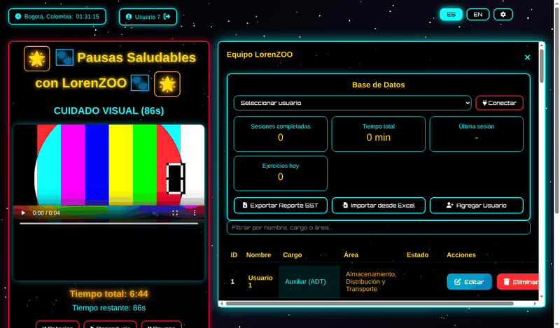
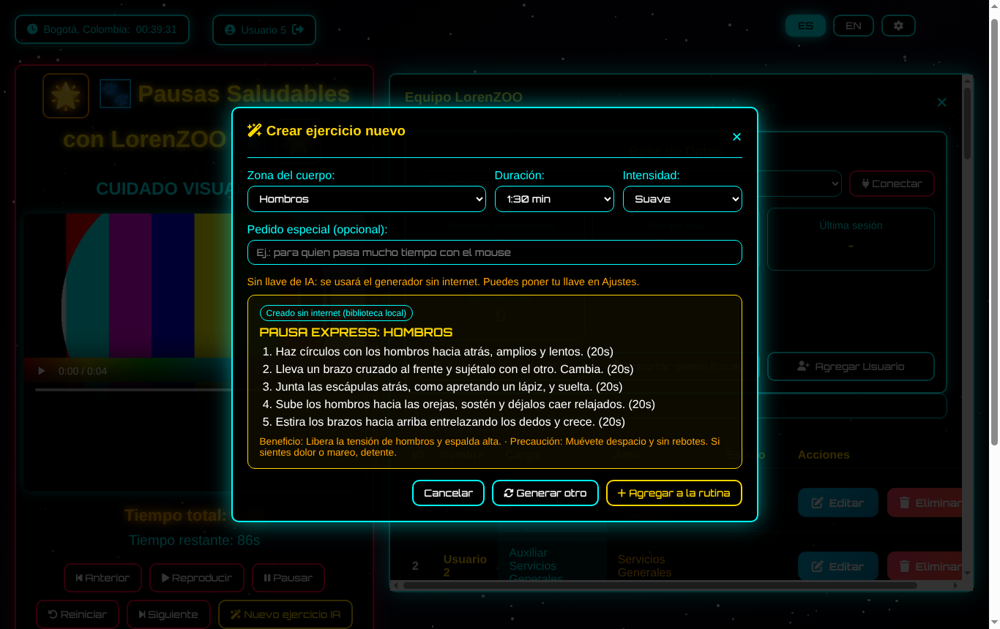
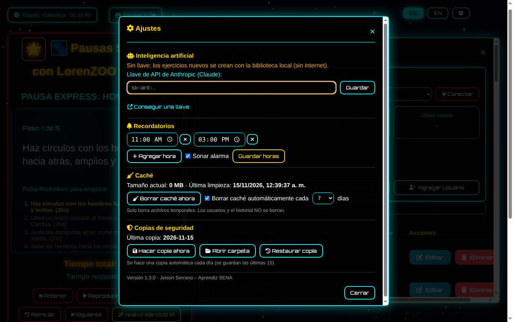

# 🌟🐾 Pausas Activas — LorenZOO

Aplicación de escritorio para el programa de **Seguridad y Salud en el Trabajo (SST)**: guía las pausas activas del equipo con videos, crea **ejercicios nuevos con inteligencia artificial**, recuerda la hora de la pausa y genera el **reporte SST en Excel**.

> Versión pública de demostración: los nombres del personal se reemplazaron por "Usuario N" y los videos no se incluyen.

**Autor:** Jeison Serrano — Aprendiz SENA · [LinkedIn](https://www.linkedin.com/in/jeison-serrano-59445b19b/)
**Tecnologías:** Electron 39 · JavaScript · HTML · CSS · ExcelJS · API de Claude (Anthropic)



## Funciones

| | |
|---|---|
| 🎬 **Rutina en video** | 5 ejercicios (visual, cuello, hombros, espalda, cadera) con cuenta regresiva; solo cuenta como hecho si no se adelanta el video. |
| ✨ **Ejercicios con IA** | Eliges zona del cuerpo, duración e intensidad y Claude crea un ejercicio nuevo, paso a paso y con temporizador. **Sin llave o sin internet** usa un generador local con movimientos seguros. |
| ⏰ **Recordatorios** | Horas configurables (11:00 y 15:00 por defecto), alarma sonora y notificación de Windows si la app está minimizada. |
| 👥 **Equipo y estadísticas** | Inicio de sesión, alta/edición/baja de personas, sesiones, minutos y ejercicios del día. |
| 📊 **Reporte SST en Excel** | Hojas *Usuarios*, *Actividad* y *Resumen* por persona, protegido con contraseña. También importa. |
| 🧹 **Caché** | Botón para borrar caché y limpieza **automática** cada N días o si pasa de 150 MB. Nunca borra los datos. |
| 🛡️ **Copias de seguridad** | Copia automática diaria (se guardan 15) y restauración. |
| 🌐 **Español / inglés** | Toda la interfaz. Funciona **sin internet**. |




## Instalar y ejecutar

```bash
npm install
npm start                 # abrir la app
npm test                  # pruebas
npm run build             # instalador de Windows en dist/
npm run cambiar-clave -- "NuevaClave"   # contraseña del reporte SST
```

- Contraseña de demostración del reporte: `demo-sst` (se cambia con el comando de arriba; solo se guarda su huella *scrypt*).
- Para la IA: ⚙ **Ajustes → Llave de API de Anthropic**. La llave se guarda cifrada con el sistema operativo (`safeStorage`) y solo la usa el proceso principal.
- Los videos van en `videos/video5.mp4`, `video7`, `video9`, `video11`, `video13`.

## Estructura

```
main.js              proceso principal: ventana, recordatorios, IPC
preload.js           puente seguro (contextIsolation + sandbox)
principal/           ia · cache · excel · respaldo · ajustes
index.html           solo estructura (CSP estricta, sin scripts en línea)
css/                 estilos originales · nuevas funciones · fuentes locales
js/                  un módulo por función (reproductor, usuarios, excel, recordatorios, ia, ajustes, respaldo, i18n…)
js/datos/            equipo, videos y biblioteca de movimientos
vendor/              Font Awesome y fuente Orbitron (sin CDN)
pruebas/             pruebas con node:test
```

## Seguridad

- `contextIsolation`, `sandbox` y sin `nodeIntegration`; la página no puede navegar ni abrir ventanas.
- Política de seguridad de contenido (CSP) sin scripts en línea; los nombres se escapan antes de mostrarse.
- La contraseña y la llave de IA nunca están en el código de la página.

Licencia MIT.
